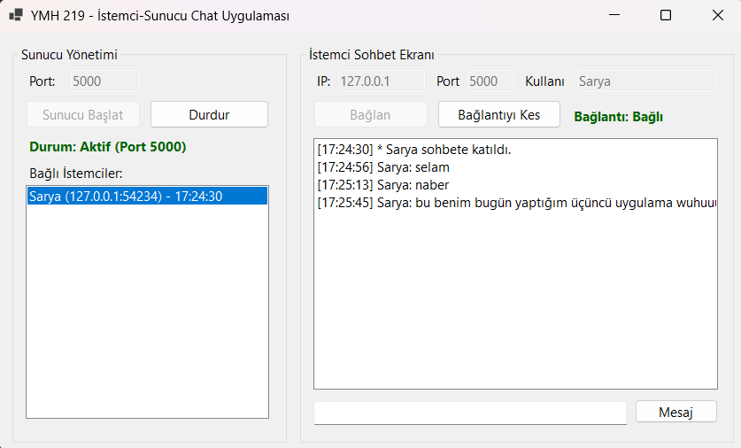
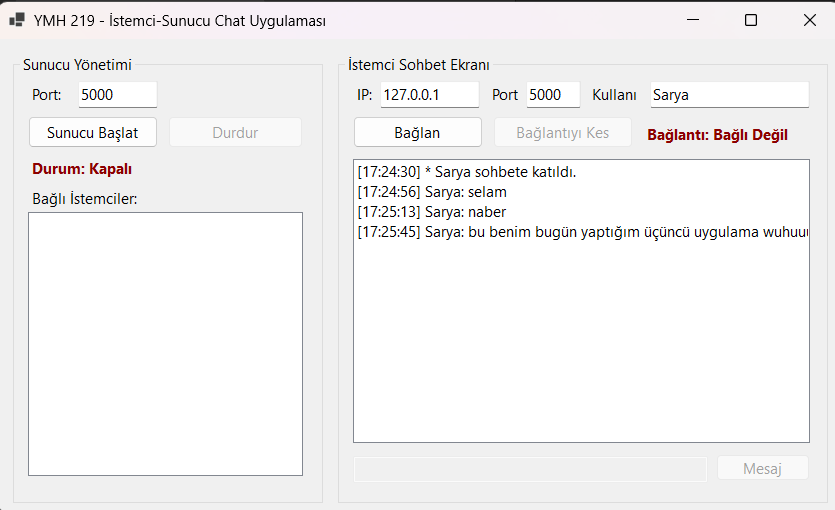

# YMH219 - İstemci-Sunucu Chat Uygulaması

C# ve .NET Windows Forms kullanılarak TCP/IP (`TcpListener` / `TcpClient`) ve `async/await` yapısıyla geliştirilmiş istemci-sunucu sohbet uygulaması. Nesne Tabanlı Programlama (YMH 219) ek uygulama ödevi kapsamında hazırlanmıştır.

## Kullanılan Teknolojiler
- C#
- .NET (Windows Forms)
- Visual Studio

## Kurulum ve Çalıştırma
1. Repoyu klonla: `git clone https://github.com/saryaasu/YMH219-ChatApp.git`
2. Proje çözüm dosyasını (`.sln` veya `.slnx`) Visual Studio ile aç
3. **F5** ile çalıştır (birden fazla istemciyi test etmek için derlenen `.exe` dosyasından ikinci bir pencere açabilirsin)

## Uygulama Kontrolleri
- **Sunucu Başlat / Durdur:** Belirtilen port üzerinden TCP dinleyicisini başlatır ve durdurur
- **Bağlan / Bağlantıyı Kes:** Kullanıcı adı, IP ve port bilgisiyle sunucuya bağlanır veya bağlantıyı sonlandırır
- **Mesaj Gönder:** Yazılan mesajı zaman bilgisiyle sohbet ekranına ve bağlı istemcilere iletir

## Temel Özellikler
- Aynı bilgisayarda veya yerel ağda çalışabilen sunucu ve istemci yapısı
- Kullanıcı adı ile bağlanma ve sunucu tarafında bağlı istemcilerin (kullanıcı adı, uç nokta, bağlantı saati) listelenmesi
- Gönderilen ve alınan mesajların zaman damgasıyla gösterilmesi
- `async/await` ve `BeginInvoke` ile arayüzün eş zamanlı ve akıcı güncellenmesi
- Geçersiz port/kullanıcı adı ve bağlantı kopması/hatalarında uygulamanın kapanmadan kullanıcıyı bilgilendirmesi
- Nesne tabanlı yapı: `BagliIstemciBilgisi`, `ChatServer`, `ChatClient` ve `Form1` sınıfları

## Ekran Görüntüleri

### Bağlantı Aktif ve İstemci Listesi

### Bağlantı Kesilmiş ve Mesaj Geçmişi Ekranı

## Bilinen Sınırlamalar / Geliştirme Notları
- Mesaj geçmişi henüz `.txt` dosyasına kaydedilmiyor
- Özel mesajlaşma veya birden fazla sohbet odası özelliği eklenmedi
- Arayüzdeki bazı buton ve metin kutularının genişlikleri ince ayar ile daha da genişletilebilir

## Öğrenci
Sarya Su Toğyıldız - 250542024